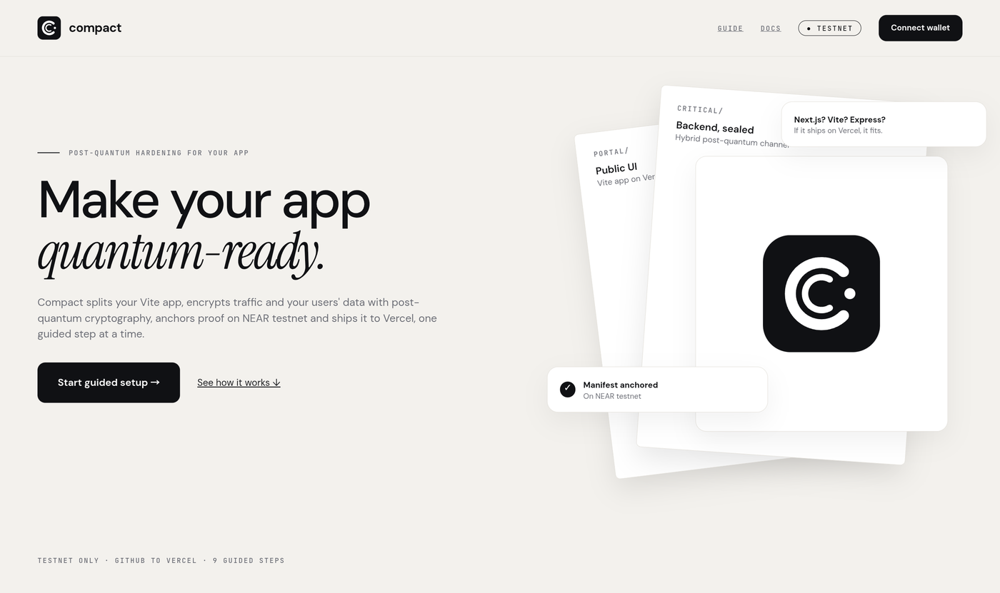
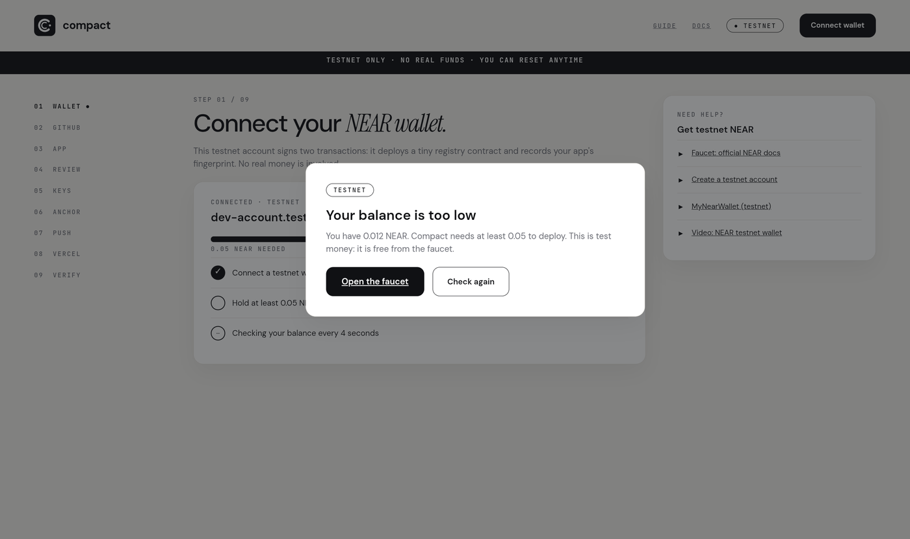
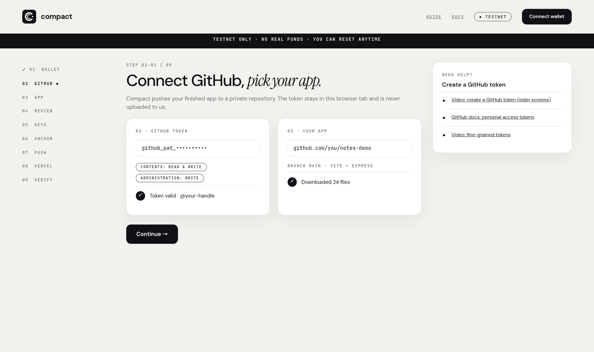
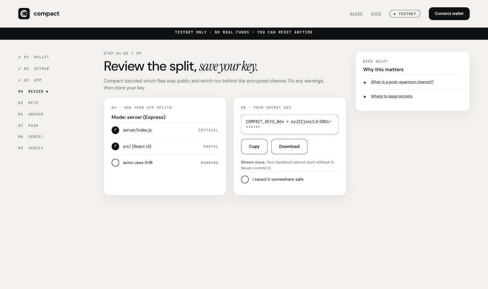
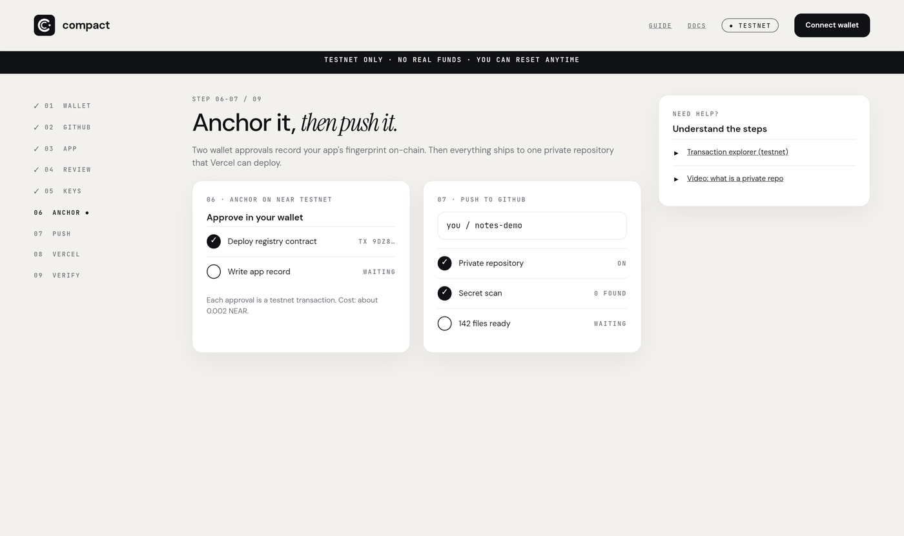
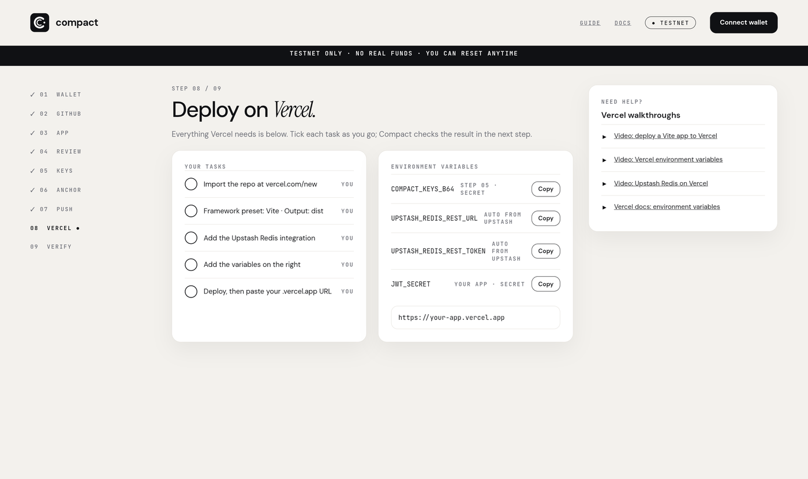
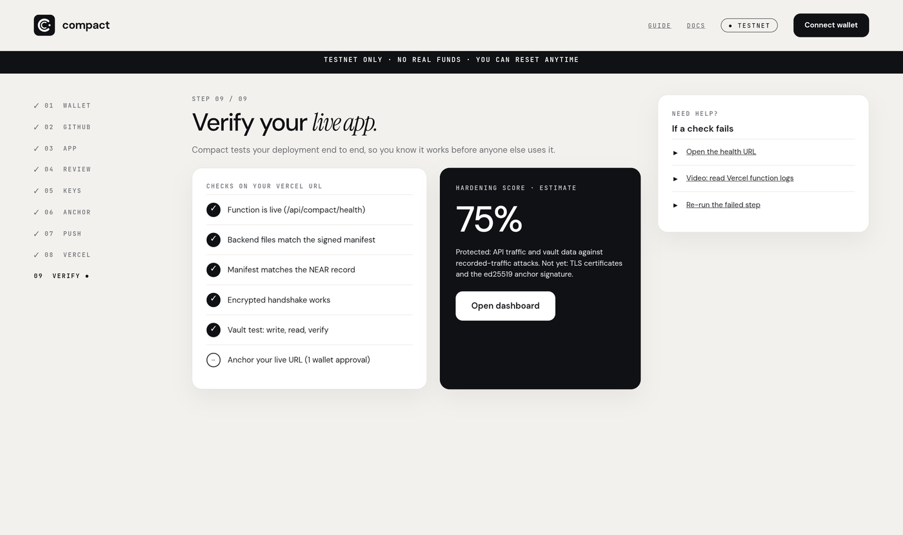

# Compact

**Compact splits a Vite + Node app into a public half and a private half, protects the private half with post-quantum cryptography, records the app's fingerprint on NEAR testnet, and ships it to Vercel through a guided web UI or a CLI.**

- Status: working prototype, **NEAR testnet only**, not security-audited.
- License: [MIT](LICENSE).
- Built for **NEAR HACKATHON** (2026-11-01 to 2026-11-14). Suggested tracks: Open Innovation (`open`), Privacy (`privacy`).
- No AI runs inside the product. The split is rule-based and deterministic, and every decision is explained.

## Problem

Apps that handle user data are exposed to "harvest now, decrypt later": traffic and stored data recorded today can be decrypted once quantum computers exist. Migrating an existing web app to post-quantum primitives is slow and easy to get wrong, and nothing lets a user prove that the backend they talk to is the backend the developer published.

## What Compact does

1. **Splits** the app: UI code stays in a public `portal/`, server code and secrets move to a private `critical/` folder.
2. **Protects** the link between them with a post-quantum channel (X25519 + ML-KEM-768 key exchange, ML-DSA-65 signatures, AES-256-GCM) and an end-to-end encrypted vault the host cannot read.
3. **Anchors** a signed manifest (hashes of the critical code, the runner key and the endpoint) in a registry contract on **NEAR testnet**. The portal reads it back and refuses to talk to a backend whose manifest differs.
4. **Ships** the result to one private GitHub repo that Vercel deploys as a Vite app with a single serverless function, and verifies the live deployment.

```
my-app/                     my-app-compact/
  index.html                  portal/    public half   -> GitHub -> Vercel (static + 1 function)
  src/...          ───────►   critical/  private half  -> read only by the function / a TEE host
  server/...                  compact/   signed manifest, runtime, receipts, keys/ (secret, git-ignored)
                                              │
                                              ▼
                                   NEAR testnet registry:  sha256(appId) -> { manifest hash, critical tree hash,
                                                                              runner key hash, endpoint }
```

## How NEAR is used

| What | Where in the code | How |
|---|---|---|
| Deployer account | `src/near/keys.mjs`, `account.mjs` | A NEAR **implicit account** (ed25519). Created by the CLI/UI, funded from the testnet faucet (≥ 0.05 NEAR needed). |
| Registry contract | `src/near/registry.mjs` | A ~300-byte WebAssembly contract assembled in JavaScript (no Rust toolchain). Methods `set(key, value)` and `get(key)`. Deployed to the deployer account. |
| App record | `src/deploy/deploy.mjs` | One transaction writes `{ manifest hash, critical tree hash, runner key hash, endpoint }` under `sha256(appId)`. Deploys are idempotent: only what changed is sent. |
| Verification in the browser | `templates/runtime/client-core.mjs` | The portal makes a free `view` call and, with `"verify": "strict"`, refuses a runner whose manifest differs from the on-chain record. |
| Vault anchoring | `src/deploy/commit.mjs`, `templates/runtime/merkle.mjs` | `compact commit` anchors one Merkle root over all vault heads, only after N writes (default 10), so most activity stays off-chain. |
| Transactions and RPC | `src/near/tx.mjs`, `borsh.mjs`, `rpc.mjs` | Transactions are built, borsh-encoded and signed in this repo (no `near-api-js`). RPC failover between `test.rpc.fastnear.com` and `rpc.testnet.near.org`. Explorer links use `testnet.nearblocks.io`. |

Each anchoring transaction costs about 0.002 testnet NEAR. NEAR does not run the app's Node code: it holds the tamper-evident record of what the backend must be.

## Hackathon disclosure

- **Built in the window.** The first commit is dated 2026-11-06. No code predates the hackathon.
- **Third-party code.** `@noble/post-quantum` (ML-KEM, ML-DSA) is the only runtime dependency of the CLI. The UI uses React, Vite and TypeScript. Deployment targets are Vercel and Upstash Redis; GitHub's REST API is used for pushing. Sample apps in `vite-express-vercel-compact/`, `express-react-starter-compact/` and the tests are generated from open-source starter projects, used only as fixtures.
- **AI-assisted development.** The code and documentation were written with AI assistance (Claude, by Anthropic) under the author's direction.
- **Other projects by the author.** None are part of this submission.

## Try it (about 5 minutes, no accounts needed for steps 1 to 3)

Requires Node 20 or newer.

1. **Install and test.**
   ```bash
   git clone https://github.com/ONOSPETER/Compact && cd Compact
   npm install && npm --prefix ui install
   npm test
   ```
   See: all tests pass (80 at the time of writing). They run offline against mocks and independent decoders.

2. **Analyze the example app.**
   ```bash
   node bin/compact.mjs analyze examples/notes-demo
   ```
   See: a table that puts `server/index.js` on the **critical** side and `src/main.jsx` on the **portal** side, with the reason for each file. Nothing is written.

3. **Transform it.**
   ```bash
   node bin/compact.mjs transform examples/notes-demo --yes
   ```
   See: a new `notes-demo-compact/` folder with `portal/`, `critical/` and `compact/` (signed `manifest.json`, `manifest.sig`, and `compact/keys/runner.secret.json`, which is git-ignored). `portal/vite.config.ts` is generated so the portal does not render a white page.

4. **Open the guided UI.**
   ```bash
   npm run ui
   ```
   Open `http://localhost:3001`. See: the landing page and the nine steps below. Step 1 asks for a funded testnet account (free from the faucet linked in the UI).

5. **Full flow on testnet** (needs a GitHub token and a Vercel account): follow the nine steps. At the end, step 9 runs five live checks against your Vercel URL (see the last screenshot).

A hosted instance of the UI can be run on Replit with the included `.replit` (build and run commands are set for deployment).

## The web UI: nine steps

The UI is a Vite + React app (`ui/`) in front of a small local API (`src/ui-server/server.mjs`) that calls the same SDK as the CLI. Both share `~/.compact`, so an app built in the CLI appears in the UI and the other way round.



**Step 1, wallet.** Creates or imports the testnet deployer account, shows the secret key once, and polls the balance. If it is below 0.05 NEAR, a dialog links to the faucet.



**Steps 2 and 3, GitHub and app.** Verifies a GitHub token (stored by the local bridge in `~/.compact/credentials.json`, mode 0600, and sent only to GitHub's API) and loads the app from a GitHub URL or a folder.



**Steps 4 and 5, review and keys.** Shows which files are critical, portal or shared, and why, plus warnings (for example, `axios` uses XHR, which does not pass through the channel). The secret key `COMPACT_KEYS_B64` is shown once.



**Steps 6 and 7, anchor and push.** Two testnet transactions (deploy the registry contract, write the app record), then a secret scan and a push of the whole app to one private GitHub repository.



**Step 8, Vercel.** A task list plus every environment variable to copy: `COMPACT_KEYS_B64`, the two Upstash Redis variables (added by the Upstash integration), and the app's own secrets.



**Step 9, verify.** Five live checks against the deployed URL: the function is live (`/api/compact/health`), backend files match the signed manifest, the manifest matches the NEAR record, the encrypted handshake works, and a vault write/read/verify round trip works. The last step anchors the live URL on NEAR. A hardening score is shown; it is the project's own rubric, not a standard.



## CLI
compact-cli github: https://github.com/ONOSPETER/Compact-CLI
```bash
node bin/compact.mjs setup                      # deployer account, GitHub token, checks (once)
node bin/compact.mjs ship ./my-vite-app --wait  # transform -> anchor on NEAR -> push to GitHub
```

| Command | What it does |
|---|---|
| `analyze <path\|github-url>` | Shows how the app would be split and why. Writes nothing. |
| `transform <path\|github-url>` | Builds `portal/ critical/ compact/`, fresh post-quantum keys and a signed manifest. |
| `deploy [--endpoint URL]` | Deploys the registry contract (once) and writes the app record on NEAR. Receipts go to `compact/receipts/`. |
| `push` / `export` | Publishes (or writes locally) one repository ready for Vercel. Secret scan first. |
| `ship` | `transform` + `deploy` + `push`. |
| `serve` | Runs the critical side locally on port 8787. |
| `vault init/put/get/list/rm/verify` | End-to-end encrypted storage, checked against the NEAR anchor. |
| `commit [--every N]` | Anchors the vault Merkle root on NEAR when enough writes accumulated. |
| `apps`, `status`, `keys`, `forget`, `account`, `doctor`, `upgrade` | Management and diagnostics. |

Every command supports `--json`, `--yes`, `--debug`, `--quiet`, `--no-color`. Exit codes: 0 ok, 1 failure, 2 usage, 3 environment, 4 network, 5 validation, 130 cancelled.

## How it works

**Splitting** (`src/analyze/`). Explicit rules classify every file: server frameworks, Node-only modules, server-only packages, secret environment variables and `server/` folders are **critical**; UI libraries, browser globals, `import.meta.env` and JSX are **portal**; helpers follow their importers; contradictions are reported as errors, not guessed. Overrides: `--critical` / `--portal` globs, `compact.config.json`, or `// @compact-critical` / `// @compact-portal` comments.

- *Server mode* (Express, Fastify, ...): the backend moves to `critical/` and runs unmodified. The portal gets `src/compact/install.mjs`, which routes same-origin `fetch('/api/...')` calls through the encrypted channel.
- *Function mode* (secrets used in client code): critical modules are replaced in the portal by generated stubs at the same path, and only the functions the portal imports are exposed.

**Build output fixes for Vercel.** The transform writes a standard `portal/vite.config.ts` (React plugin, `outDir: 'dist'`) and keeps the app's own config as `vite.config.*.orig`, because a Vite app without the React plugin renders a blank page. It also drops scripts such as `cd server && npm run build`, because the server folder is no longer part of the portal and `tsc` would fail with `TS18003: No inputs were found`.

**Channel** (`templates/runtime/core.mjs`, `pq.mjs`). Hybrid X25519 + ML-KEM-768 key exchange, ML-DSA-65 signed manifest, AES-256-GCM records. On Vercel, sessions are sealed tickets, so any function instance can answer; replay protection uses Redis `SET NX`.

**Vault** (`templates/runtime/vault.mjs`, `merkle.mjs`). Data is encrypted on the client with a 256-bit key that never leaves it, padded to fixed buckets (4 KB to 1 MB) and stored as opaque blobs. The host sees ciphertext, a pseudonymous id, IP and timing. It cannot read, edit or silently roll back data, because blobs are hash-checked and the Merkle root is anchored on NEAR.

**Keys.**

| Key | Where | Secret |
|---|---|---|
| Deployer (ed25519, NEAR) | `~/.compact/keystore.json`, mode 0600, optional passphrase | yes |
| Runner keys (ML-KEM, ML-DSA) | `compact/keys/runner.secret.json` (git-ignored) and `COMPACT_KEYS_B64` on the host | yes |
| Portal connection info (`connect.json`, `manifest.json`) | in the portal | no, public by design |

**Fault tolerance.** Atomic file writes with a cross-process lock, quarantined corrupt files, RPC failover, transactions signed once and re-broadcast safely, idempotent and resumable deploy and push, and a secret scan before every push.

## What has and has not been verified

- Verified by tests (`npm test`): classification, transform output, manifest signing, the channel, the vault, the Vercel handler, the UI bridge, the on-chain registry encoding.
- Verified on a live deployment: the five checks of step 9 (health, manifest, NEAR record, handshake, vault) on Vercel with Upstash Redis, as in the last screenshot.
- Not done: mainnet, TEE attestation verification (the registry anchors the manifest, not a TEE measurement), NEAR's own post-quantum account keys.
- Classical parts that remain: TLS certificates and NEAR transaction signatures (ed25519).
- Known limits: cookie auth, WebSockets and axios's default XHR adapter do not pass through the channel (warnings are shown); TypeScript server entries must be compiled first; analysis is regex-based, so dynamic imports are reported as warnings.

## Tests
Test project: 
original github: https://github.com/avinava/simple-vite-react-express

Transformed compact version: https://github.com/ONOSPETER/test3

Site on vercel: https://test3-chi-khaki.vercel.app/

## Security notes

- Testnet only. Use a dedicated deployer account: the registry contract does not check callers.
- Never commit `compact/keys/` or `.env` files. The generated `.gitignore` excludes them, and `push` aborts if its secret scan finds one.
- The UI bridge has no login. Run it locally, or treat a hosted copy as a shared demo and never enter a GitHub token with broad scope into it.

## Repository layout

```
bin/compact.mjs          CLI entry
src/analyze/             file classification rules
src/transform/           portal/critical split, vite.config.ts, script fixes
src/near/                keys, borsh, transactions, RPC, registry contract
src/deploy/              deploy, commit, push, Vercel assembly, serve
src/github/              GitHub client and push
src/ui-server/           local API used by the UI
templates/runtime/       code copied into generated projects (channel, vault, Merkle, serverless)
ui/                      guided web UI (Vite + React + TypeScript)
examples/notes-demo/     tiny Vite + Express app for trying the flow
docs/screenshots/        UI screenshots used in this README
test/                    node --test suite
```

## License

MIT. See [LICENSE](LICENSE).
